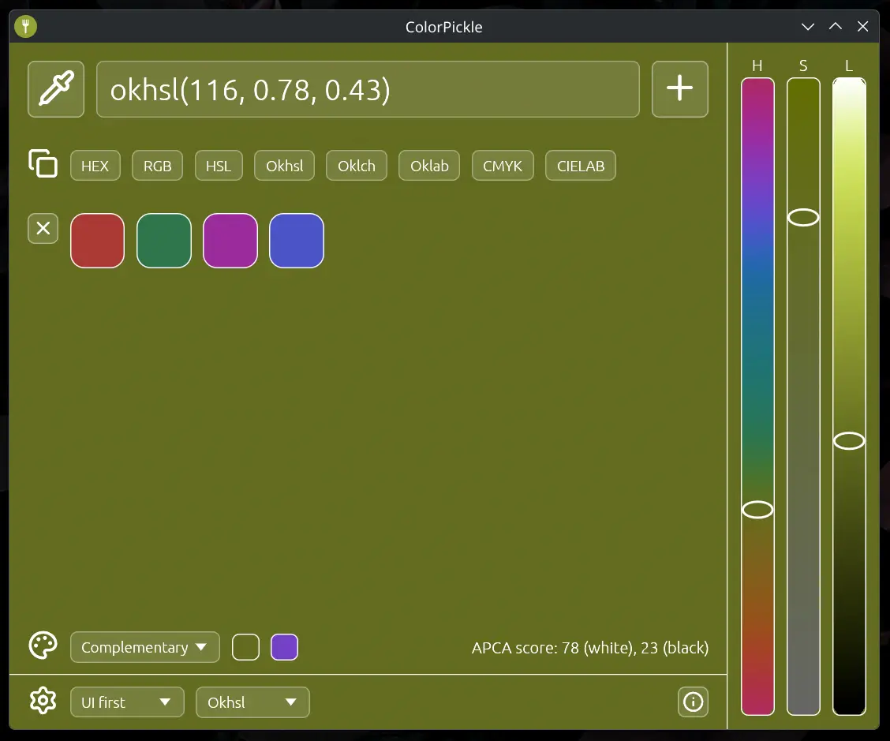
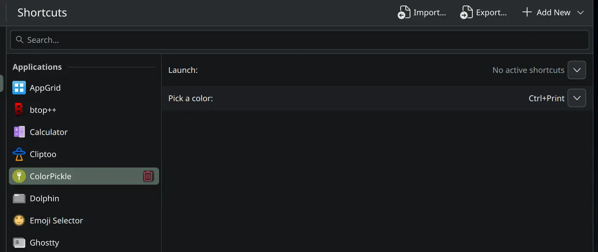

# ColorPickle

Linux screen color picker. Pick a pixel or drag-select a region with a magnified picker, using any common color format. Launch to GUI or straight to picker.



Assign shortcut to launch the GUI or screen picker:



## Features

- Fullscreen picker overlay with a magnified view of the area under the cursor
- Click to pick a single pixel, or drag to select a region and pick its averaged color
- `Esc` or right-click cancels the picker
- Copy as HEX, RGB, HSL, HSV, Oklch, Oklab, Okhsl, P3, or CMYK
- Keyboard shortcuts `1`–`9` copy the respective format
- Input any supported format, or a CSS color name to set the color
- The main window is the current color, with contrast-adjusted controls
- Gradient Hue/Saturation/Lightness sliders
- APCA contrast scores of the current colour on white and black
- History of the last 8 picks — click one to reuse it, hover and click × to remove it, or clear the list
- `+` button beside the input adds the current colour to history
- Color-harmony swatches (complementary, split complementary, analogous, triadic, tetradic, rectangle) — click a swatch to use it
- Launch-mode, default-format and precision (Practical/Precise) selectors, saved to the config file
- About panel with the logo, version, log level, and the config, history, log and binary paths
- Screen capture on KDE Plasma (`ScreenShot2`), other Wayland compositors (`ext-image-copy-capture`) and X11, falling back to the XDG desktop portal

## Install

[Download latest release](https://github.com/dcog989/ColorPickle/releases/latest) - `.deb`, `.rpm`, or `.AppImage` as needed.

- Arch Linux (AUR): `yay -S colorpickle` (or `paru`)
- Debian/Ubuntu (`.deb`): `sudo apt install ./colorpickle_*.deb`
- Fedora/RHEL/openSUSE (`.rpm`): `sudo dnf install ./colorpickle-*.rpm`
- AppImage (any distro): `chmod +x ColorPickle-*.AppImage`

> [!NOTE]
> On KDE Plasma, running the app from AppImage prevents use of the fast *ScreenShot2*. It therefore falls back to a slower method, such as XDG desktop portal.

## Install from source

Clone this repository:

```sh
just install   # release build, then install to /usr (prompts for sudo)
```

`just` is required for this, plus the native build dependencies listed under [Build](#build); the recipes are thin wrappers over `cargo`.

## Configuration

Settings live in `~/.config/colorpickle/config.toml` (or `$XDG_CONFIG_HOME/colorpickle/config.toml`). The app writes it whenever you change a setting; edit it with the app closed.

```toml
launch_mode = "ui_first"     # ui_first | picker_first
default_format = "hex"       # hex | rgb | hsl | hsv | oklch | oklab | okhsl | p3 | cmyk
precision = "practical"      # practical | precise
log_level = "info"           # error | warn | info | debug | trace
```

- `--launch-mode ui_first|picker_first` overrides `launch_mode` for one run
- `--log-level` overrides `log_level` for one run (see [Logs](#logs))
- Pick history is kept apart in `~/.local/state/colorpickle/state.toml` (or `$XDG_STATE_HOME/colorpickle/state.toml`), so picking never rewrites your settings

## Development

```sh
cargo install cargo-edit cocogitto cargo-outdated   # `cargo set-version`, `cog`, `cargo outdated`
lefthook install                                    # install the git hooks; lefthook must be on PATH
```

## Logs

Logs are written to `~/.local/state/colorpickle/log/` (or `$XDG_STATE_HOME/colorpickle/log/`), one file per day named `colorpickle.log.<date>`; the 7 most recent are kept.

- `--log-level error|warn|info|debug|trace` sets the verbosity; the default is `info`
- `log_level` in `config.toml` does the same, and is overridden by the flag
- `RUST_LOG` overrides both, e.g. `RUST_LOG=colorpickle=debug,wgpu=warn`
- The same lines are mirrored to stderr, with colour when stderr is a terminal

## Build

Rust 1.99 or newer; `rust-toolchain.toml` pins that version for rustup users.

Native build dependencies: `pkg-config`, Wayland and `libxkbcommon` development headers.

- Debian/Ubuntu: `sudo apt install pkg-config libwayland-dev libxkbcommon-dev`
- Arch: `sudo pacman -S --needed pkgconf wayland libxkbcommon`

```sh
just build                               # release build
just check                               # clippy (deny warnings), formatting check, then tests
just lint                                # clippy only
just --list                              # all recipes
cargo build                              # debug build
cargo fetch && cargo outdated -w         # check for updates above semver range
cargo fmt --check                        # formatting check
cargo fmt                                # format all files
cargo run                                # build and run
cargo upgrade && cargo update --verbose  # update Cargo.lock and dependencies to latest with semver ranges

cargo clean                              # clean build artifacts
```

## Packaging

```sh
cargo install cargo-deb cargo-generate-rpm   # once
just package                                 # .deb, .rpm and AppImage into target/
```

Building the AppImage also needs `linuxdeploy` on `PATH`, or its path in `LINUXDEPLOY`.

## License

[GNU General Public License v3](LICENSE)
