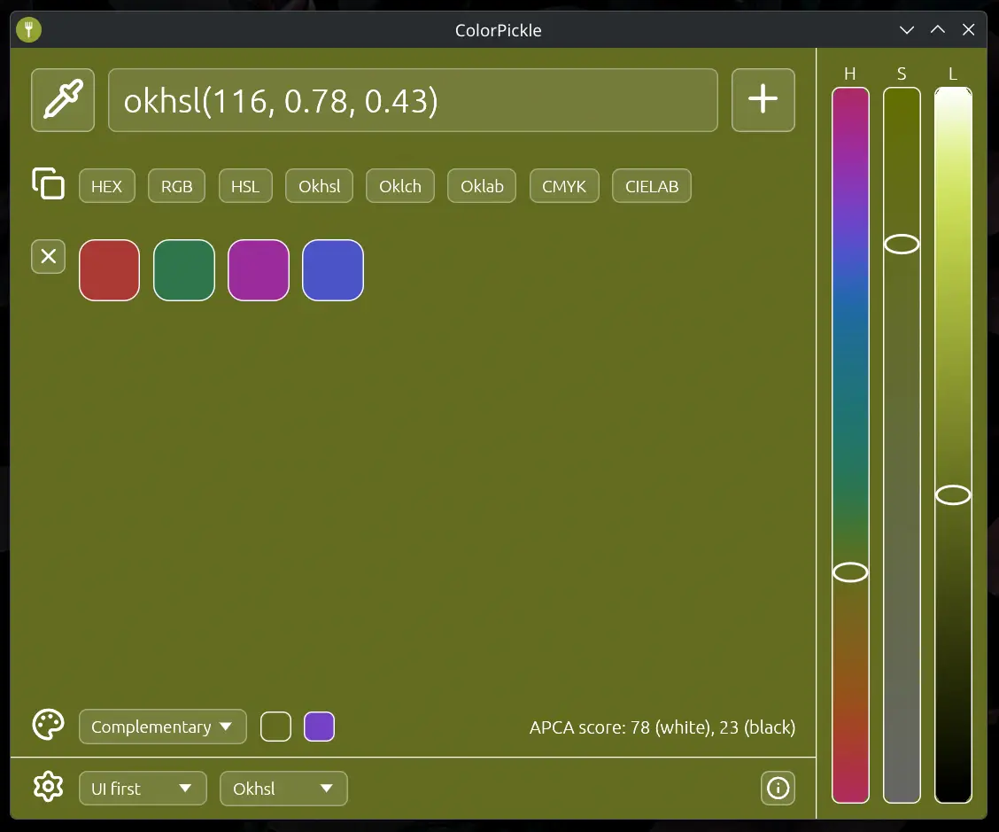
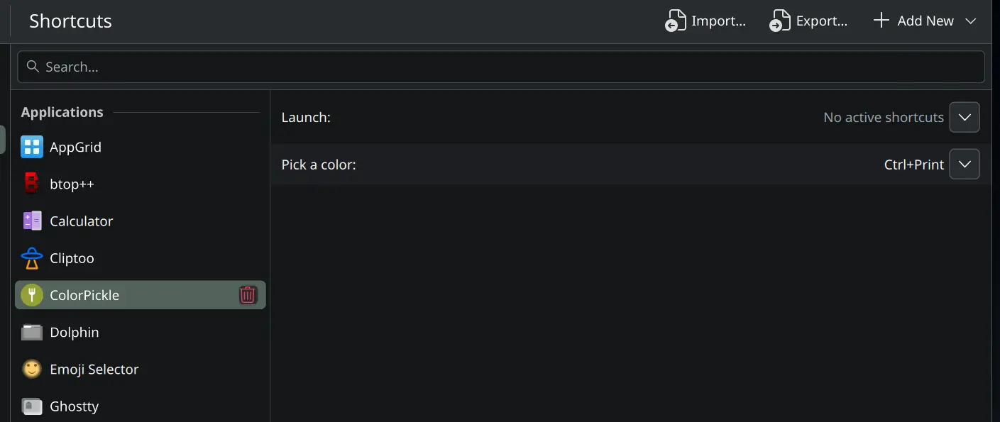

# ColorPickle

Linux screen color picker: pick a pixel or drag-select a region with a magnified picker; returns any common color format; launch to GUI or straight to picker.



Assign shortcut to launch the GUI or screen picker:



## Features

- Fullscreen picker overlay with a magnified view of the area under the cursor
- Click to pick a single pixel, or drag to select a region and pick its averaged color
- Copy as HEX, RGB, HSL, HSV, Oklch, Oklab, Okhsl, P3, or CMYK
- Keyboard shortcuts `1`–`9` copy the respective format
- Input any supported format, or a CSS color name to set the color
- The main window is painted with the current color, with contrast-adjusted controls
- Gradient Hue/Saturation/Lightness sliders
- APCA contrast scores of the current color on white and black
- History of the last 9 picks — click one to reuse it
- Color-harmony swatches (complementary, split complementary, analogous, triadic, tetradic, rectangle) — click a swatch to use it
- Launch-mode, default-format, precision (Practical/Precise) and magnifier-zoom (2x/4x/8x) selectors
- Screen capture: `ScreenShot2` on KDE; `ext-image-copy-capture` on other Wayland compositors; `GetImage` on X11; XDG portal as last resort on Wayland

## Install

[Download latest release](https://github.com/dcog989/ColorPickle/releases/latest):

| Platform                 | Format     | Install                                                                   |
| ------------------------ | ---------- | ------------------------------------------------------------------------- |
| Arch / CachyOS           | `.tar.zst` | `tar --zstd -xf colorpickle-*.tar.zst && sudo ./colorpickle-*/install.sh` |
| Debian / Ubuntu          | `.deb`     | `sudo apt install ./colorpickle_*.deb`                                    |
| Fedora / RHEL / openSUSE | `.rpm`     | `sudo dnf install ./colorpickle-*.rpm`                                    |
| Linux                    | AppImage   | `chmod +x ColorPickle-*.AppImage && ./ColorPickle-*.AppImage`             |

> [!NOTE]
> The AppImage uses the slower XDG desktop portal method for screen capture.

---

## Configuration

Settings live in `~/.config/colorpickle/config.toml` (or `$XDG_CONFIG_HOME/colorpickle/config.toml`). The app writes it whenever you change a setting; edit it with the app closed.

```toml
launch_mode = "ui_first"     # ui_first | picker_first
default_format = "hex"       # hex | rgb | hsl | hsv | oklch | oklab | okhsl | p3 | cmyk
precision = "practical"      # practical | precise
zoom = "x4"                  # x2 | x4 | x8 (picker magnifier)
log_level = "info"           # error | warn | info | debug | trace
```

- `--launch-mode ui_first|picker_first` overrides `launch_mode` for one run
- `--log-level` overrides `log_level` for one run
- Pick history is kept apart in `~/.local/state/colorpickle/state.toml` (or `$XDG_STATE_HOME/colorpickle/state.toml`), so picking never rewrites your settings

---

## Development

### Requirements

Rust 1.100, `just`, `pkg-config`, `lefthook`, Wayland and `libxkbcommon` development headers; `zstd`.

- Debian/Ubuntu: `sudo apt install just pkg-config libwayland-dev libxkbcommon-dev zstd`
- Arch: `sudo pacman -S --needed just pkgconf wayland libxkbcommon zstd`
- `lefthook` install from AUR or [release packages](https://github.com/evilmartians/lefthook/releases)

```sh
cargo install cargo-edit cocogitto cargo-outdated   # cargo set-version, cargo upgrade, cog, cargo outdated
cargo install cargo-deb cargo-generate-rpm          # deb and rpm generators
lefthook install                                    # install the git hooks; lefthook must be on PATH
```

Building the AppImage needs `linuxdeploy` on `PATH`, or its path in `LINUXDEPLOY`.

### Build

```sh
just --list         # all recipes

just                # verify the repo: lint, format check and tests CI runs.
just build          # release build
just check          # clippy, formatting check, tests
just clean          # clean build artifacts
just format         # format all files
just lint           # clippy only
just run            # debug build and run
just test           # tests
just update         # latest allowed versions; just outdated to preview

just install        # install from source
just package        # .deb, .rpm, AppImage and tarball into target/
just release        # bump version and push
```

---

## License

[GNU General Public License v3.0](LICENSE)
